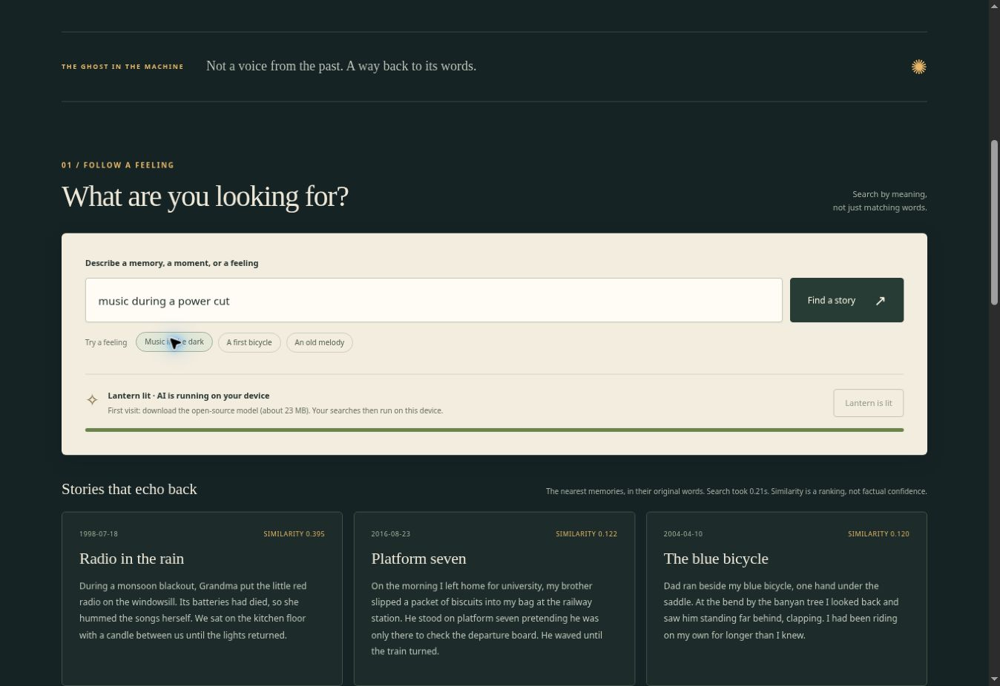

*This is a submission for the [Hacktoberfest Open-Source AI Challenge Week 4: Ghost in the Machine](https://dev.to/challenges/hacktoberfest-week4-2026-10-26).*

## What I Built

I typed **“music during a power cut.”**

The note I wanted used neither “music” nor “power cut.” It described a monsoon blackout, a little red radio with dead batteries, and Grandma humming songs on the kitchen floor.

Ghostlight found it.

That small connection is the project: **a memory archive you can search when you remember the moment but have forgotten its words.** An open-source embedding model runs in your browser and retrieves the passages you saved.

For *Ghost in the Machine*, I imagined the ghost as a trace left in an archive: a recipe, a familiar song, someone waiting on a railway platform. The machine's job is to make that trace reachable again. Every result shows the original text.

The six example memories, including the radio story, are fictional. They let anyone try the idea without contributing a private family story. You can then add short memories of your own or import an archive.

## Demo

[Try Ghostlight in your browser](https://ghostlight-memory-lantern-2026.coatedaspen1.chatgpt.site).

Click **Light the lantern**, then try these searches. Here is what I observed in a Chromium browser using the actual WebAssembly model on 1 November 2026:

| Search | First result or notice | Top similarity |
| --- | --- | --- |
| `music during a power cut` | Radio in the rain | 0.395 |
| `how someone taught me to ride` | The blue bicycle | 0.405 |
| `quantum processors on Mars` | “No close connection found” | 0.057 |

These are three checks against six fictional notes, not an accuracy benchmark. The unrelated query still displays the nearest original passages, clearly labelled as weak matches. The 0.25 notice threshold is a simple interface heuristic; it is not a calibrated confidence boundary.

Next, add a fictional memory and export the archive as JSON. You can import that file to bring the words back. Saving in the browser is optional; the default is session only.

The first visit downloads roughly 23 MB of model weights plus runtime files. An internet connection is needed for that download. Subsequent inference processes the notes and query on the device. Browser caching varies, so complete offline operation is not a guarantee.

## Code

[Browse the Ghostlight source code](https://github.com/Anudhyan/ghostlight-hf26).

The application code is MIT licensed. The README credits the model and dependencies under their own licenses. OpenAI Codex assisted with implementation, documentation, and validation, including the browser checks described here.

## How I Built It

Ghostlight uses plain HTML, CSS, and JavaScript, served as static files.

The central component is [all-MiniLM-L6-v2](https://huggingface.co/sentence-transformers/all-MiniLM-L6-v2), used through [Xenova's ONNX conversion](https://huggingface.co/Xenova/all-MiniLM-L6-v2). [Transformers.js](https://github.com/huggingface/transformers.js), pinned to version 3.8.1, runs the quantized model with WebAssembly inside a Web Worker.

The retrieval flow is small enough to inspect:

1. Convert each saved passage into an embedding, using mean pooling and normalization.
2. Convert the search phrase into an embedding with the same model.
3. Compare those vectors with cosine similarity and rank the passages.
4. Show the retrieved text exactly as it was stored.

The worker keeps model loading and inference away from the interface thread. It caches embeddings for unchanged notes and evicts entries when their source text changes. Model and library versions are pinned so the implementation is easier to reproduce.

The model earns its place in the app. “Hummed songs” and “music” can be close in its embedding space; exact string matching alone cannot make that connection. The final display still comes directly from the archive.

Testing found an unglamorous bug: adding a note relied on `crypto.randomUUID`, which was unavailable on the HTTP preview origin. I added a `getRandomValues` fallback, then verified adding a fictional note, saving it across a reload, exporting it, and importing it again. The automated archive and vector checks pass too. The repository includes the browser observations and a separate reproducible CPU-inference test; scores can vary between the CPU and browser backends.

This version intentionally handles a small archive: up to 100 notes, with 1,000 characters per note. English paraphrases are its tested use case. Long family histories and multilingual retrieval deserve more evaluation before making bigger claims.

## Why Does Open Innovation Matter?

For this archive, open innovation changes where the useful work happens. Downloadable model weights and an open runtime let the browser compute embeddings itself. Ghostlight sends no note or query text to an inference service, and local inference has no per-query API charge.

The reader can inspect the retrieval code, replace the model, or serve their own copy. JSON export keeps the words portable even if the interface changes later. Those choices matter for something intended to hold personal memories.

Local processing has limits. Hosting, CDN, and model providers receive ordinary asset-download requests. Optional `localStorage` is unencrypted and accessible to other people using the same browser profile. A small model can rank the wrong story, which is why the source passage and similarity label stay visible.

The detail I keep returning to is the radio with dead batteries. The saved words are already there; the useful thing the machine does is help someone find them again.
